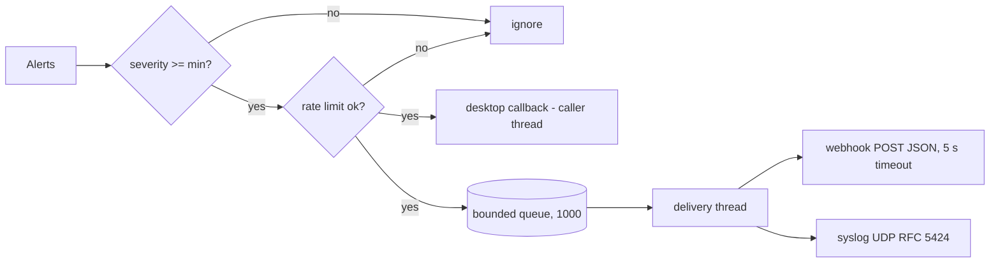

# Design: NetSentinel enhancements

## New and changed modules
```
netsentinel/
  settings.py      NEW  Settings: typed defaults, validation, atomic JSON save (E5)
  timeline.py      NEW  AlertTimeline: per-minute buckets by rule (E6, Qt-free)
  simulation.py    NEW  generate_round(): simulated traffic, shared by SimWorker and headless (E7)
  interfaces.py    NEW  list_interfaces(): scapy, falling back to psutil (E3)
  notify.py        NEW  Notifier: filter, rate limit, webhook/syslog delivery thread (E8, Qt-free)
  headless.py      NEW  run_headless(): CLI capture loop and JSONL alert log (E7, Qt-free)
  charts.py        NEW  AlertChart(QWidget): stacked bars drawn with QPainter (E6)
  store.py         CHG  alerts() filters, alert(id), related_packets() (E4, E9)
  workers.py       CHG  SimWorker uses simulation.generate_round
  gui.py           CHG  interface picker, filters, detail panel, chart, Notifications tab, settings binding
  app.py           CHG  argparse CLI: --headless, --list-interfaces, --db, ...
tests/             NEW  pytest suite (E2)
requirements.txt, README.md   NEW (E1)
```
Import rule: `settings`, `timeline`, `simulation`, `interfaces`, `notify` and `headless` don't import PyQt6.
`app.main` imports the GUI only when neither `--headless` nor `--list-interfaces` is given.

## Settings (E5)
- `DEFAULTS` is a dict of key to default value. A loaded value is accepted only if its type matches the
  default's type (bool is not accepted for int) and it passes an optional validator, for example the TTL
  range or a valid severity.
- `FORCED_ON_LOAD = {'dry_run': True}` is applied after loading. `ips_enabled` is not a setting at all.
- `save()` writes `settings.json.tmp`, then `os.replace`, then `chmod 0600`. Save errors are reported
  through `last_error` and never raise into the GUI.
- `MainWindow` binds each widget's change signal to `settings.set(key, value)`, which saves right away.
  The file is small, so no debounce is needed.

## Alert filters (E4)
`Store.alerts(limit, severity=None, rule_id=None, status=None, ip=None)` builds the `WHERE` clause from
fixed column names with `?` parameters. The IP text uses `LIKE ? ESCAPE '\'`, with `%` and `_` escaped.

## Alert detail (E9)
- `Store.alert(alert_id)` returns one row.
- `Store.related_packets(ip, limit)` returns packets where `src_ip=?` or `dst_ip=?`, newest first.
- The GUI merges them with matches from `recent`, a deque of 5,000 packets. Merged rows are deduplicated
  on (timestamp, src, dst, sport, dport, proto) and the newest 50 are shown.

## Timeline and chart (E6)
- `AlertTimeline(bucket_seconds=60, buckets=30)` has `add(rule_id, t)` and `series(now)`. `series`
  returns `(rule_ids, [Counter per bucket])` in oldest-to-newest order and drops events outside the range.
- `AlertChart.set_series(...)` stores the data and calls `update()`. `paintEvent` draws axes, stacked bars
  (colors from a fixed palette, assigned in rule-id order) and a legend. `MainWindow.tick` refreshes it
  once per second, only while the dashboard tab is visible.

## Notifications (E8)

- `NotificationSettings` is a dataclass with `validate()`, which returns a list of error messages.
- Payload: the alert fields plus `app` and `sent_at`. Evidence goes through `redact_evidence` unless `include_evidence` is set.
- Syslog: `<PRI>1 TIMESTAMP HOST netsentinel - - - MESSAGE`, where PRI = 16·8 + severity code
  (CRITICAL=2, HIGH=3, MEDIUM=4, LOW=5).
- Desktop in the GUI uses `QSystemTrayIcon.showMessage` when the system tray is available, otherwise the status bar.
- If the queue is full, the alert is counted in `dropped` and not sent. Delivery errors are rate limited
  and passed to an `on_error` callback.

## Headless (E7)
- Sources are generators that yield a `Packet`, or `None` on an idle tick, so the loop can check the stop
  conditions regularly:
  - `sim`: `generate_round` with a 0.12 s pause between rounds.
  - `pcap`: `PcapReader`.
  - `live`: `AsyncSniffer` feeding a bounded queue, read with a 0.2 s timeout.
- For each packet: `detector.process(p)`, then write each alert as one JSON line (flushed), print a
  summary line, and pass the alerts to the notifier.
- Once per second, `expire_blocks()` runs. A daemon thread refreshes protected addresses every 30 s.
- `KeyboardInterrupt` stops the loop. `finally` closes the source, notifier and store, then prints the summary.

## Testing (E2)
- `conftest.py` provides `store` (temporary DB, closed after the test), `detector` and a `pkt()` factory.
- Optional dependencies use `pytest.importorskip('scapy')` and `pytest.importorskip('PyQt6')`.
- GUI tests run with `QT_QPA_PLATFORM=offscreen` and replace `QMessageBox` functions so no dialog blocks.
- Webhook tests use a local `http.server` thread. Syslog tests use a local UDP socket.
