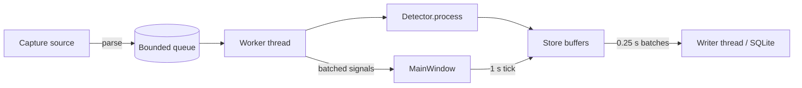

# Design: IDPS rewrite

## Package layout
```
NetSentinel_IDPS_v5.py      launcher: from netsentinel.app import main
netsentinel/
  __init__.py
  config.py      constants, rule seeds, migration defaults, regex patterns
  models.py      Packet, Alert, utc(), redact_evidence()
  addresses.py   canonical_ip, normalize_network, PrefixIndex, protected addresses
  store.py       Store (SQLite, writer thread, blocklist, trusted list)
  detector.py    EventWindow, FlowBuffer, BoundedMap, Detector
  parsing.py     scapy -> Packet
  workers.py     QThread workers: live, sim, pcap, WinIPS, LinuxIPS, blocklist import
  gui.py         MainWindow
  app.py         main(), crash logging
legacy/          previous single-file versions (kept for reference)
```
Dependencies flow one way: `config → models → addresses → store → detector → parsing → workers → gui → app`.
Only `workers.py` and `gui.py` import PyQt6 (R9.2).

## Data flow

The inline IPS workers call `Detector.process(inline=True)` directly in their receive loops,
because the drop/accept verdict depends on the result.

## Detector state (R3.5, R3.6)
- `EventWindow`: a deque of `(time, key)` plus a `Counter` of keys. `add()` and `trim(now, span, cap)`
  keep both in sync, so `len()` gives the event count and `unique()` gives the distinct-key count.
  This replaces the separate deque and Counter dictionaries of v5, which could get out of sync.
- `FlowBuffer`: HTTP fragments per flow, with time, count and byte limits (R3.4).
- `BoundedMap`: an `OrderedDict` with `touch(key)`, which creates the entry or moves it to the end, then
  evicts from the front while over the cap. The touched key is always last, so it can't be evicted.
  `prune(predicate)` is used by garbage collection.

| Table | Key | Window key | Rule |
|-------|-----|-----------|------|
| `syn_rate` | src | – | NET-002 |
| `port_scan` | (src, dst) | dst port | NET-001 |
| `syn_to_dst` | dst | src | NET-003 |
| `synack_from` | server (SYN/ACK sender) | – | NET-003 ratio |
| `horizontal` | (src, dst port) | dst | NET-004 |
| `stealth` | src | – | NET-005 |
| `icmp` | src | – | ICMP-001 |
| `dns` | src | qname | DNS-001 |
| `http_flows` | (src, dst, sport, dport) | FlowBuffer | WEB-001 |

NET-004 is keyed by `(src, port)` rather than src. This puts the per-port host count directly
in one window and removes the cross-table bookkeeping v5 needed.

`inspect()` runs one `_check_*` method per rule in the v5 order, under one lock. `process()`
applies the inline and auto-block policy (R4.3, R4.4) and writes alerts and packets to the store.

## Store
- One shared connection (`check_same_thread=False`) guarded by an `RLock`, used for reads and
  small writes. One writer thread with its own connection flushes buffers every 0.25 s.
- If a flush fails, the system rolls back and puts rows back at the front of the buffers, as far
  as there is room. Rows that don't fit are counted in `buffer_drops`.
- Blocklist and trusted entries are kept in memory and mirrored to SQLite. Lookups use an immutable
  `PrefixIndex` (sorted interval starts plus running maximum ends, then `bisect`). Each change builds
  a new index and swaps the reference, so packet-path lookups never take the lock.
- `blocks_version` increments on every blocklist change, so the GUI refreshes the list only when it changed.
- Rule migration: `PREVIOUS_RULE_DEFAULTS` maps each rule to a list of old `(threshold, window)` pairs.
  A row is updated only if it matches one of them. v5 listed NET-002's current value as an "old"
  default, which hid its real old default (400, 5). This version fixes that.

## Protected addresses
`ProtectedAddresses` holds frozensets of local and infrastructure addresses. `refresh()` runs the
discovery (getaddrinfo, psutil, `/proc/net/route`, `route print`, `ipconfig /all`, `resolv.conf`)
and then swaps the sets in. The packet path only reads the current sets (R8.3).

## GUI
`MainWindow` keeps the v5 layout and controls. Refresh logic:
- Packets: when a packet batch has arrived since the last tick.
- Alerts: when `store.alert_generation` changes, meaning the writer has committed new alerts.
- Blocklist: when `store.blocks_version` changes.

## Error handling
- Worker loops catch per-packet exceptions, report them (rate limited to one per 10 s per message), and fail open.
- `app.main` installs `sys.excepthook` and `threading.excepthook`, which append to the crash log.

## Verification plan
- `pyflakes` on the package and the launcher.
- A headless detector probe with a temporary database sends traffic that triggers each of the nine rules.
- Policy probes: dry-run gives `WOULD_DROP`, active mode gives `DROP`, and auto-block needs 2 WEB-001 hits to a local destination.
- Store probes: protected and trusted blocks are refused, imports are deduplicated, entries expire, and a v5 database opens unchanged.
- A GUI smoke test opens `MainWindow` with Qt's offscreen platform and a temporary database, runs a simulation for a few seconds, and closes it cleanly.
