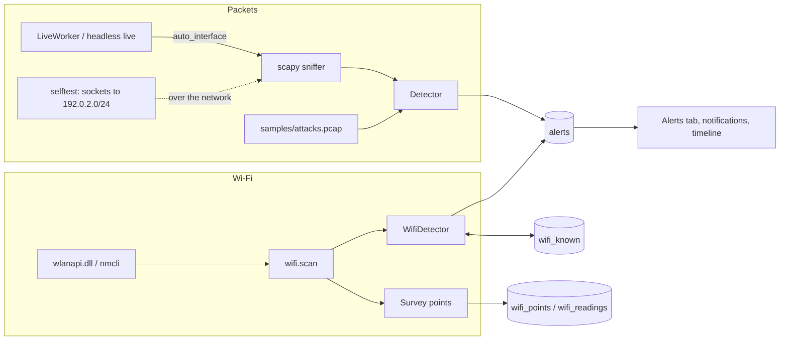

# Design: IDPS testing aids and Wi-Fi monitoring

## Overview

The new features live in four new modules, with small hooks into the existing ones. Packet detection is unchanged. Wi-Fi rules run on scan results, not packets, and feed the same alert pipeline.

| Module | Purpose | Requirements |
|--------|---------|--------------|
| `interfaces.py` (extended) | `choose_interface()` and `auto_interface()` | T1 |
| `selftest.py` (new) | Self-test traffic and result evaluation | T2 |
| `samples.py` (new) | Deterministic sample PCAP, demo rule and demo blocklist | T3 |
| `wifi.py` (new) | Scanners, security decoding, `WifiDetector`, `--wifi-scan` | T4, T5 |
| `wifi_gui.py` (new) | `WifiTab` and `SignalMap` widgets | T6 |

## Architecture

## Components and Interfaces

### Adapter selection (T1)
`choose_interface(candidates)` is a pure function over `Candidate(name, address, up, loopback, route_metric)`, so it can be tested without real adapters. `_candidates()` builds the list as follows:
- **Link state:** from scapy's `conf.ifaces` and psutil's `net_if_stats().isup`. A scapy `DISCONNECTED` flag overrides psutil.
- **Route metric:** from the default routes in scapy's `conf.route.routes`, matched by `network_name`.

`LiveWorker.run` and headless live capture call `auto_interface()` only when no interface was chosen.

### Self-test (T2)
`run_self_test(thresholds, log, should_stop, tcp, udp)` sends one burst per step. Each burst is the rule's threshold plus 5:

| Step | Traffic |
|------|---------|
| NET-001 | non-blocking `connect()` to random ports 1000-1999 on 192.0.2.10 |
| AUTH-001 | non-blocking `connect()` to 192.0.2.10:22, each from a new source port |
| NET-004 | `connect()` to 192.0.2.1..N on port 443 |
| NET-006 | UDP to random ports 2000-2999 |
| DNS-001 | DNS A queries for random names in `.invalid`, at least threshold + 5 characters long |

Each socket is held for 1.5 s so its SYN leaves, then closed. Ordinary sockets are used because scapy's L3 send picked the route of an unplugged adapter during testing.

`evaluate(expected, alerts)` returns `(detected, missed)`, counting only alerts whose destination is in TEST-NET-1. The callers are:
- **Headless:** `_SelfTestState` and `_start_self_test`. The sender thread starts 2 s after capture. The loop exits when all rules are detected, or 4 s after the last packet.
- **GUI:** `MainWindow.run_self_test`. It runs a `SelfTestWorker`, collects alerts in `on_alert_batch`, and reports 4 s after sending finishes.

### Samples (T3)
`build_packets()` uses a fixed RNG seed and a fixed start time. Each scenario gets a 30-second slot, so rule windows never overlap. `client_hello(name)` builds a minimal TLS ClientHello that `parsing.tls_sni` can read. `write_samples(folder)` writes `attacks.pcap`, `demo.rules` (sid 9000001, `http.uri` content) and `blocklist.txt` (203.0.113.66).

### Wi-Fi scanning (T4)
`scan(wait)` dispatches by platform, then keeps one entry per BSSID (the strongest) and sorts by signal.
- **Windows:** ctypes calls to the Native Wifi API, in this order:
  1. `WlanOpenHandle`
  2. `WlanEnumInterfaces`, preferring the connected adapter
  3. `WlanScan`, then wait 4 s (drivers must finish within 4 s)
  4. `WlanQueryInterface` with opcode 7 to read the current connection
  5. `WlanGetNetworkBssList`

  `lRssi` gives dBm. `ulChCenterFrequency` gives the channel and band. Security comes from `security_from_ies(ies, privacy)`, which reads the RSN AKM and cipher suites and the WPA vendor element.
- **Linux:** `nmcli -t -e yes ... device wifi list --rescan yes`, parsed by `parse_nmcli` (escaped colons are handled). dBm is approximated as quality / 2 - 100.

### Wireless rules (T5)
`WifiDetector.inspect(result, now)` loads the enabled WIFI-* rules and the trusted list. It then checks each AP in this order:
1. WIFI-002 (evil twin)
2. WIFI-001 (open or WEP)
3. WIFI-003 (unknown AP), only if WIFI-002 did not match that AP

Cooldowns are per `(rule, BSSID)` for the rule's Window and are pruned after 24 h. `SECURITY_RANK` orders the security labels so that "weaker" can be compared. The `Detector.load` horizon ignores rules whose id starts with `WIFI-`.

### Wi-Fi GUI (T6)
- **`WifiScanWorker(detector, interval=None)`:** a QThread that scans once, or repeatedly when `interval` is set. It runs `WifiDetector`, stores the alerts, and emits `scanned`, `alert_batch` and `error`. It reports a persistent error once.
- **`WifiTab`:** owns its workers. Its `shutdown()` stops them and waits up to 8 s each, and `MainWindow.closeEvent` calls it first.
- **`SignalMap`:** draws the floor plan scaled to fit and stores click positions as fractions from 0 to 1. The heat map is a 64-column inverse-distance-weighted (IDW) grid, cached until the points change. Alpha fades to zero at 0.35 of the plan width from the nearest reading.

`wifi_gui` imports helpers from `gui`, so `gui` imports `WifiTab` inside `_build` to avoid a circular import.

## Data Models

New SQLite tables, created with `CREATE TABLE IF NOT EXISTS` so existing databases upgrade in place:

| Table | Columns |
|-------|---------|
| `wifi_known` | `bssid` PK, `ssid`, `security`, `created_at` |
| `wifi_points` | `id` PK, `name`, `x`, `y` (0 to 1 or NULL), `timestamp` |
| `wifi_readings` | `point_id`, `ssid`, `bssid`, `rssi`, `signal`, `channel`, `band`, `security`, indexed by `point_id` |

There are 3 new rule seeds (WIFI-001 to WIFI-003), inserted with `INSERT OR IGNORE`. There are 3 new settings, each validated: `wifi_monitor` (bool), `wifi_interval` (15 to 3600) and `wifi_floor_plan` (path). The new CLI flags are `--self-test` and `--wifi-scan`.

## Correctness Properties

### Property 1: Disconnected adapters are never chosen
For any candidate list, `choose_interface` never returns a candidate with `up=False`, `loopback=True`, or an address that is not routable.
**Validates: Requirements T1.1, T1.2**

### Property 2: Self-test stays in TEST-NET-1
Every destination the self-test sends to is inside `192.0.2.0/24`.
**Validates: Requirements T2.1**

### Property 3: Self-test volume follows thresholds
For each exercised rule, the number of distinct ports, hosts, source ports or names sent is greater than that rule's threshold.
**Validates: Requirements T2.2**

### Property 4: Sample replay is complete
Replaying `attacks.pcap` with default rules, `demo.rules` and `blocklist.txt` raises all 14 packet rules.
**Validates: Requirements T3.2**

### Property 5: Security decoding is total
`security_from_ies` returns a label from `SECURITY_RANK` for any byte string, including truncated input.
**Validates: Requirements T4.2**

### Property 6: No twin alert without evidence
With an empty trusted list, APs of the connected SSID with equal or stronger security never raise WIFI-002.
**Validates: Requirements T5.3**

### Property 7: WIFI-003 needs a baseline
With an empty trusted list, WIFI-003 never fires.
**Validates: Requirements T5.4**

### Property 8: Cooldown
For a given rule and BSSID, two alerts are at least the rule's Window apart.
**Validates: Requirements T5.5**

## Error Handling

- **Self-test with no route:** `SelfTestError` with a plain message. Headless prints it and exits with 1. The GUI shows it.
- **Windows API errors:** code 5 names the Location setting, code 1062 names the WLAN AutoConfig service, and other codes are reported with their number.
- **Linux without nmcli:** a clear error. A non-zero exit reports nmcli's stderr.
- **Bad floor-plan image:** a warning, and the setting is cleared.
- **A scan that fails during monitoring:** reported once, and monitoring continues.
- **An encrypted beacon whose security element cannot be read:** labelled `Unknown`, so it is not reported as WEP.

## Testing Strategy

Verification run during implementation:
- **Existing suite:** `pytest` (157 tests), with the rule-count assertions updated for 17 rules, plus `pyflakes netsentinel tests`.
- **Self-test, headless and GUI:** run against real Wi-Fi capture. All 5 rules were detected, without admin rights.
- **Sample replay:** headless replay raised 13 rules, and IOC-001 fired once the blocklist was loaded.
- **Wi-Fi:** a live `--wifi-scan` on Windows. A probe script also covered IE decoding for each security type, channel mapping, nmcli parsing, each WIFI-002 case, WIFI-003 baseline gating, cooldowns, a disabled rule, survey storage, and an offscreen GUI run (scan, trust, floor plan, 3 points, heat map, CSV export, monitoring).

Task 9 in `tasks.md` turns these probes into permanent tests.
